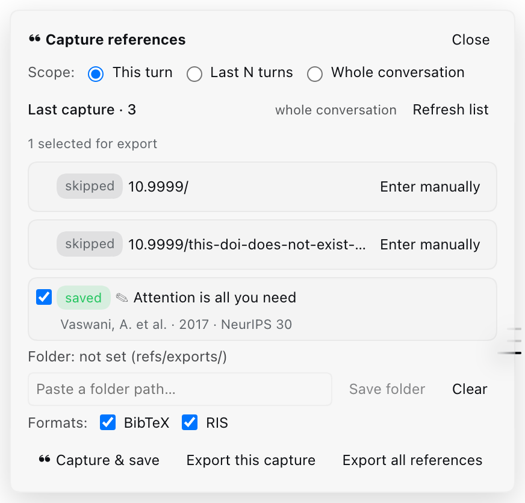
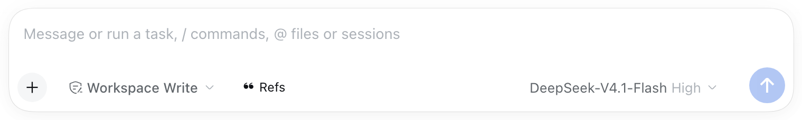
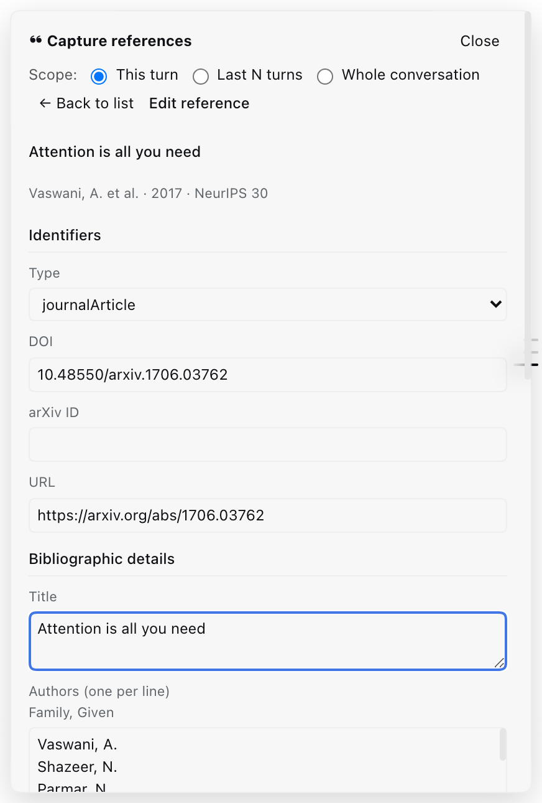

# dsh-refkeeper

**English** · [简体中文](README.zh.md)

 [](https://www.npmjs.com/package/dsh-refkeeper) [](https://awesome-dsh-plugin.com)

Long research conversations scatter citations across turns, tool results and summaries. dsh-refkeeper extracts references from the conversation you choose, checks their metadata against six scholarly registries, and turns them into traceable entries with annotations and BibTeX, RIS and CSL-JSON export. DataCite can search technical report numbers, and Open Library can find book candidates from ISBNs. A lookup hit is not verification: the title, year and first-author checks still apply, and an ISBN without a title remains quarantined. A registry disagreement is kept in quarantine instead of being treated as verified.



If this plugin saves you time, a star on GitHub helps other people find it. If you hit a bug or want a feature, open an issue — Chinese or English, either is fine. I read all of them and add the useful ones to the roadmap.

## Contents

[Features](#what-it-does) · [Supported identifiers](#supported-identifiers) · [Supported reference formats](#supported-reference-formats) · [Why this matters](#why-not-just-copy-the-citations-by-hand) · [Install](#install) · [Use](#use) · [Output](#what-the-output-looks-like) · [Verification](#how-a-paper-is-accepted-or-rejected) · [Privacy](#data-and-privacy) · [Development](#development) · [Changelog](#changelog) · [License](#license)

## What it does

- **Collects citations.** Scope can be one turn, the last N turns, or the whole session. It recognises DOIs, arXiv ids, PMIDs, PMCIDs, ISBNs and report numbers, and also reference lines written in APA, GB/T 7714, IEEE, BibTeX or Vancouver style. Supported historical arXiv category IDs — for example, `math.GT/0309136` and `cs/0112017` — are recognised too.
- **Checks them against registries.** An entry is accepted only if the title matches, the year is within one year, the first author matches, and at least one registry returned a record. There are six registries: Crossref, OpenAlex, arXiv, DataCite, PubMed and Open Library.
- **Writes annotations.** After a capture, the model already running the session writes four short fields per entry: a summary, why the paper is relevant here, a supporting quote, and caveats. A quote that does not appear in the conversation is dropped.
- **Exports.** BibTeX, RIS, explicit CSL-JSON, or both (BibTeX + RIS). The export can cover the last capture, the entries you ticked, or the whole library. PMIDs and PMCIDs go into the export as well.
- **Says where the references are stored.** After a capture the panel tells you how many references it stored and that they live in the workspace's `refs/refs.json`. The folder below is where the `.bib`, `.ris` and `.json` export files are written, not where the library is.

## Supported identifiers

| Identifier | Accepted examples |
| --- | --- |
| DOI | `10.1002/joc.1688`; `https://doi.org/10.1002/joc.1688` |
| arXiv | `2401.01234`, `arXiv:2401.01234v2`, `https://arxiv.org/abs/2401.01234v2`; legacy `math.GT/0309136`, `arXiv:math.GT/0309136v2` |
| Link carrying an identifier | `https://arxiv.org/format/2401.01234`, `https://doi.org/10.1002/joc.1688`, `https://www.biorxiv.org/content/10.1101/2020.01.01.123456` |
| PubMed | `PMID: 12345678`; `PMCID: PMC1234567` |
| ISBN | ISBN-10 `0-306-40615-2`; ISBN-13 `978-0-306-40615-7` |
| Report number | `NUREG-1234`; `PB123456`; `NACA 1234`; `NTRS 123456`; `AD-A123456`; `DOE/BR-123456`; `NASA/TM-2020-12345`; `EPA-600/R-14/001`; `RFC-9110` |
| Book identifiers | LCCN `81001630` (`https://lccn.loc.gov/81001630`); OCLC `9264983` (`https://www.worldcat.org/oclc/9264983`); Open Library `OL4256224M` (`https://openlibrary.org/books/OL4256224M`) |

PMID and PMCID must include their labels. An unlabeled 6–8 digit number such as `20240101` is ignored, so dates and sample IDs are not mistaken for papers. Routing is identifier-specific: DOI searches Crossref, DataCite and OpenAlex; arXiv IDs search arXiv; PMID searches PubMed; PMCID uses PMC search/crosswalk; ISBN searches Open Library; and report numbers search DataCite. Title-only references search Crossref, OpenAlex and arXiv. At most three sources are queried concurrently. For example, mentioning a book with its [Open Library page](https://openlibrary.org/books/OL4256224M) carries the book identifier into the saved reference; it does not itself verify the book.

## Supported reference formats

A reference pasted as a line rather than as an identifier is parsed too.

| Format | Example |
| --- | --- |
| APA | `Smith, J. (2020). A study of something. Journal of Testing, 12(3), 45-67.` |
| GB/T 7714 | `张三, 李四. 一种标题很长的中文文献标题测试用例[J]. 某某学报, 2020, 12(3): 45-67.` |
| IEEE | `[1] A. Smith, "A titled paper," Journal of Testing, vol. 12, no. 3, pp. 45-67, 2020.` |
| BibTeX | `@article{key, title = {A Study}, author = {Smith, John}, year = {2020}, doi = {10.1000/x}}` |
| Vancouver | `1. Smith J, Doe A. A study of something. Journal of Testing. 2020;12(3):45-67.` |

A BibTeX entry can be pasted in bulk: several blocks in one message are read as
several references. `@string` macros are expanded and nested braces are
balanced, so `title = {A {DNA}-based method}` arrives as one title, and an
entry without a title is skipped rather than stored empty.

A standard number is not a reference. `ISO 9001`, `GB/T 12345` and `RFC 1918`
are read as text but never become entries, because a research conversation
mentions them far more often than it cites them. A report number that really
is a report — `NACA 1234`, `NTRS 123456`, `DOE/BR-123456`, `NASA/TM-2020-12345`,
`RFC-9110` — does become one.

## One button in the composer

The interface gains exactly one thing: an item in the composer's tool row, standing next to the work-mode and model pickers. It reads `❝ Refs` (Chinese UI: `❝ 引用`). There is no sidebar, no toolbar and no floating widget — press it and the capture panel opens in the top-right corner of the window, close it and the row is back to what it was.



## Why not just copy the citations by hand

For three papers, copy by hand. Past that it is slow and easy to get wrong: one DOI sits in a tool result, an APA line sits in a summary, another paper is only mentioned by name two turns earlier.

Asking the model for a `.bib` file is faster, but models make up page ranges, DOIs and author order, and the mistake is usually found at submission time.

| | Copy by hand | Ask a model for a `.bib` | This plugin |
| --- | --- | --- | --- |
| Source of the list | your reading | the model's memory | parsed from the conversation you select |
| Metadata checked | no | no | Crossref, OpenAlex, arXiv, DataCite, PubMed, Open Library |
| What happens to a paper that cannot be confirmed | n/a | kept | moved to `refs/quarantine.json`, excluded from export |
| Invented pages, DOIs, authors | n/a | possible | fields come from registry records; unsupported fields stay empty |
| Why the paper is there | lost | lost | annotation plus a verbatim quote |
| Same export twice | n/a | unlikely | identical bytes; entries sorted, citekeys stable |
| Citations you never used | not included | included | excluded by default: tool output is not treated as a citation |

## Install

In DSH open **Settings → Plugins → Add plugin** and enter `dsh-refkeeper`. The package is published on npm, so this is one step and runs no build: the tarball ships the built `lib/`. Enable it for the current profile, then reload.

To track the repository instead of the published version, paste the Git address `https://github.com/ymwang92/dsh-refkeeper` into the same dialog. The repository commits `lib/` too, so that route needs no build either.

For host-independent citation helpers, import the pure API subpath: `import { extractIdentifiers } from 'dsh-refkeeper/core'`. It does not require DSH host APIs.

### Configuration

Registry verification works with the built-in endpoints and needs no API key. In `refs/settings.json`, `registryBaseUrls` can override the base URLs for Crossref (`api.crossref.org`), DataCite (`api.datacite.org`), OpenAlex (`api.openalex.org`), arXiv (`export.arxiv.org`), PubMed (`eutils.ncbi.nlm.nih.gov`), and Open Library (`openlibrary.org`); its map keys are `crossref`, `datacite`, `openalex`, `arxiv`, `pubmed`, and `openlibrary`. The same file supports an optional `mailto` contact address for registry requests. The panel shows whether each endpoint is using its default or a custom URL. Only HTTP(S) endpoints are accepted; invalid values produce a warning, are ignored, and do not stop capture.

Private mode is opt-in and is controlled by `privateMode` in `refs/settings.json`. When enabled, capture, `ref_verify`, `/refs verify`, re-verification, and non-manual promotion make **no registry requests**. Captured references are saved as manual entries and clearly marked **not verified**; use manual confirmation or promote with `--manual` when appropriate. Annotations still use the model selected for the current session.

The panel's **Export to** path is stored in `refs/settings.json` and must stay inside the session workspace; the library remains at `refs/refs.json`.

## Use

1. Open a conversation that cited papers and open the capture panel above the composer.
2. Choose the scope, then **Capture references**.
3. The panel lists what was saved and what went to the ⚠ quarantine. Untick any entry you do not want.
4. Choose BibTeX, RIS, or CSL-JSON, then **Export this capture**.

When the scan budget truncates a capture, the command and panel say that the newest complete messages totaling N characters were kept and older content was omitted. The saved batch retains the truncation flag and scanned character count.

CSL-JSON exports standard CSL bibliographic fields. Refkeeper verification status is not a CSL-JSON field, so the export does not distinguish verified references from manual entries; keep the annotated record if you need that status.

The same steps as commands:

```text
/refs capture --scope=all --save
/refs export --format=both
/refs export --format=csl-json
```

Files are written to `refs/` inside the session's workspace. BibTeX, RIS and CSL-JSON files use `.bib`, `.ris` and `.json` extensions. To export into a specific folder, paste its path in the panel once; it is remembered in `refs/settings.json`. Folders outside the session workspace are refused, because the host only allows writes inside it.

## What the output looks like

`refs/annotated.md` is the reading copy:

```markdown
### Physiographically sensitive mapping of temperature and precipitation across the conterminous United States

- Daly, C.; Halbleib, M.; Smith, J. I. et al. · 2008 · International Journal of Climatology 28 15 2031-2064 · DOI [10.1002/joc.1688](https://doi.org/10.1002/joc.1688)
- verification: **verified** 3/3 · crossref, openalex

> **Summary** — PRISM interpolation: temperature and precipitation grids for the conterminous US, built from station data with a physiographic adjustment.
> **Why it matters** — the dataset behind the 800 m climatology in section 3.
> **Evidence** — "we use the PRISM 800 m normals (Daly et al., 2008) as the baseline for the downscaling."
```

and the matching BibTeX entry:

```bibtex
@article{daly2008physiographically,
  author = {Daly, C. and Halbleib, M. and Smith, J. I. and Gibson, W. P. and Doggett, M. K.},
  title = {Physiographically sensitive mapping of temperature and precipitation across the conterminous United States},
  journal = {International Journal of Climatology},
  year = {2008},
  volume = {28},
  number = {15},
  pages = {2031--2064},
  publisher = {Wiley},
  doi = {10.1002/joc.1688},
  url = {https://doi.org/10.1002/joc.1688},
  abstract = {PRISM interpolation: temperature and precipitation grids ...}
}
```

If the citation in the conversation lacked volume, issue, pages, publisher or language, those come from the registry record. Fields that neither the conversation nor a registry supports are left out of the file entirely.

## How a paper is accepted or rejected

```text
conversation text
   │  identifiers: DOI, arXiv id, labeled PMID/PMCID, ISBN, report number, LCCN, OCLC, Open Library ID
   │  reference lines: APA, GB/T 7714, IEEE, BibTeX, Vancouver
   ▼
candidates ──► identifier-specific sources
                 DOI: Crossref / DataCite / OpenAlex · arXiv: arXiv
                 PMID: PubMed · PMCID: PMC search/crosswalk
                 ISBN: Open Library · report number: DataCite
                 title only: Crossref / OpenAlex / arXiv
                 (at most three sources queried concurrently)
   │
   ├─ accepted when: title matches · year within ±1 · first author matches
   │                 and at least one registry returned a record
   ├─ accepted ──► refs/refs.json        (verified)
   └─ rejected ──► refs/quarantine.json  (⚠, kept and visible, not exported by default)
```

`unverified` is a third status, used when the registries could not be reached. The entry stays in the library and can be retried later; a network failure is not evidence that a citation is wrong. `quarantined` means the registries answered and disagreed.

## Annotations

Four fields: `summary`, `relevance`, `evidence`, `caveats`. They are written after a capture by the profile's default model, from the conversation lines that mention the paper. A prompt rule and a parser filter both reject sentences that describe the absence of information ("the excerpt does not mention this work"); such a field is stored as empty and omitted from the export, so BibTeX gets no empty `note` and RIS gets no empty `N1`.

The model call happens once per capture, with a 60 second cap, and covers at most 12 entries. Entries beyond that budget, or captures without a reachable model, keep their bibliographic fields and the capture result says why annotations were skipped. The `ref_save` tool still accepts annotations you write yourself, and existing user annotations are never overwritten.

## Chinese references

GB/T 7714 reference lines are parsed along with APA, IEEE, BibTeX and Vancouver. Chinese titles are matched against registry records by character bigrams (Dice ≥ 0.90) rather than word tokens, because romanised records otherwise never match. `language` is carried into both export formats.

Registry coverage for Chinese journals is thin: CNKI, Wanfang and CQVIP links are only used to extract identifiers, not queried as registries. Expect more manual correction there than for a paper with an English DOI.

## The panel


| Control | What it does |
| --- | --- |
| Scope | this turn, the last N turns, or the whole session |
| Capture references | captures, verifies, annotates and stores; the result lists what was saved and what went to the quarantine |
| Where it is stored | the line above the list says how many references this capture stored and that they live in the workspace's `refs/refs.json` |
| Row checkbox | which entries the next export includes; saved rows are ticked, ⚠ rows are not |
| Badge | the state of the row at a glance: saved, ⚠ quarantined, skipped, failed |
| Sub-line | first author · year · venue, plus the reason when the check failed |
| Click a row | opens an independent edit page instead of expanding inside the list |
| Three field groups | identifiers (type, DOI, arXiv id, PMID, PMCID, ISBN, report number, LCCN, OCLC, Open Library ID, URL), bibliography, publication |
| Book-link identifiers | LCCN, OCLC and Open Library ID now appear in the panel's identifier group and can be edited back into the reference record. |
| Entry type | a dropdown of the seven types; free text fails silently at export time |
| Manual entry | a skipped row can be completed here and stored |
| Format | BibTeX, RIS, CSL-JSON, or both (BibTeX + RIS) |
| Export to | where `.bib`, `.ris` and `.json` files are written; empty means `refs/exports/` |
| Export this capture | writes the ticked entries |
| Export all references | writes the whole library |

The list scrolls on its own: the panel is a fixed header and footer around a scrolling middle, so the export buttons stay reachable however many references the capture brought in.

Opening a row gives you an independent edit page, with the fields grouped into identifiers, bibliography and publication:



## Commands

| Task | Command |
| --- | --- |
| Preview what the conversation cites | `/refs capture --scope=all --dry-run` |
| Capture and store | `/refs capture --scope=lastN --turns=5 --save` |
| Check one reference | `/refs verify --doi=10.1002/joc.1688` |
| Read the library | `/refs list [--quarantine]` |
| Fill in missing volume, pages, publisher | `/refs enrich [--quarantine]` |
| Promote verified quarantine entries | `/refs promote [--ids=<payload>]` or `/refs promote --manual --reason=<text>` |
| Edit one field | `/refs edit --id=<id> --payload=<base64url(json)>` |
| Remove entries | `/refs remove <id\|doi\|arxiv>...` or `/refs remove --all --yes` |
| Export | `/refs export [--format=bibtex\|ris\|csl-json\|both] [--all] [--ids=...] [--out=path]` |
| Set the export folder | `/refs dir --set=<base64url(path)>` or `/refs dir --clear` |

<details>
<summary>Full command reference</summary>

```text
/refs                                                     capture readiness
/refs capture [--scope=turn|lastN|all] [--turns=N] [--save] [--dry-run] [--include-tools]
/refs verify --doi=... | --arxiv=... | --title=... [--json]
/refs save --json='{...}'
/refs list [--limit=N] [--quarantine]
/refs edit --id=<id> --payload=<base64url(json)>
/refs enrich [--quarantine]
/refs promote [--ids=<payload>] [--manual --reason=<text>]
/refs remove <id|doi|arxiv>... [--quarantine]
/refs remove --all --yes [--quarantine]
/refs export [--format=bibtex|ris|csl-json|both] [--out=path] [--include-quarantine]
/refs export [--ids=id,id] [--choose-dir] [--all]
/refs dir [--set=<base64url(path)>|--clear]
```

`/refs promote` re-verifies quarantine entries against live registries and moves only `verified` results. `--ids` narrows it to the rows you ticked in the panel, which is what the two buttons on a quarantined row send: "Re-verify" runs the checks, "Store as manual" moves the row with a recorded `manual` status and a reason. A promoted entry that already exists in the library replaces that row instead of leaving the old record behind.

Without `--save`, `/refs capture` only previews candidates. Export defaults to the
last saved capture; `--all` exports the library instead. Long identifiers are
passed base64url-encoded because real ids contain spaces, `<>`, `;` and parentheses.

The same work is stored once even if both tables knew about it: a reference that
quarantined first and was captured successfully later is merged by identity
(DOI, arXiv id, ISBN or title + year), and `remove` / `edit` apply to both
tables so the leftover copy cannot resurface in an `--include-quarantine`
export.

</details>

## Tools

| Tool | Purpose |
| --- | --- |
| `ref_capture` | collect candidate references from the conversation |
| `ref_verify` | check one identifier or title against the registries |
| `ref_save` | store a reference with annotations you supply |
| `ref_export` | write BibTeX/RIS for a batch, a selection, or the library; use `/refs export --format=csl-json` or the panel for CSL-JSON |
| `ref_ping` | report which host services and registries are reachable |

## Files

```text
refs/refs.json          accepted references, with their annotations
refs/quarantine.json    ⚠ entries that failed the check
refs/last-capture.json  result of the last capture; default export scope
refs/settings.json      remembered export folder
refs/annotated.md       reading copy: record, verdict, annotations
refs/exports/           default export destination
```

All plain JSON and Markdown, so they can be committed with the manuscript and diffed.

## Limits

- It is not a replacement for Zotero. Zotero handles a personal library across years (PDFs, styles, sync). This plugin covers the citations in one manuscript, as they appear in a conversation.
- It does not read PDFs. Everything comes from the conversation text and the registries.
- Exports are limited to the session workspace by the host's sandbox.
- A capture spends one model call (60 second cap) and annotates at most 12 entries.
- Registry metadata for Chinese journals is sparse; see above.

## Data and privacy

- By default, registry verification sends a reference's title and any available identifier needed for the check to the relevant configured registry endpoint(s): Crossref, DataCite, OpenAlex, arXiv, PubMed, and Open Library. Each source uses its own configurable base URL; an optional `mailto` contact address is included in requests.
- Private mode is opt-in and disables all outbound registry requests for capture, `ref_verify`, `/refs verify`, re-verification, and non-manual promotion, so no titles or identifiers are sent. Capture still saves entries as manual and marks them **not verified**; manual confirmation or `--manual` promotion remains available. It does not claim those references were registry-checked.
- Annotations use the model already configured in the session; the plugin holds no API key of its own. No telemetry. The library is a local file.

## Development

```sh
npm ci
npm test          # vitest
npm run typecheck
npm run build     # tsdown for the host bundle, then the client bundle
```

`tsdown` clears `lib/`, so run the client bundle afterwards. Node 22 or newer.

## Changelog

What changed in each release, and why, is in [CHANGELOG.md](CHANGELOG.md).

## License

MIT. See [LICENSE](LICENSE).
