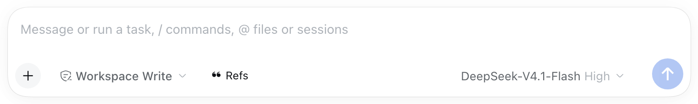

# dsh-refkeeper

**English** · [简体中文](README.zh.md)

 [](https://www.npmjs.com/package/dsh-refkeeper) [](https://awesome-dsh-plugin.com)

A [DeepSeek Harness](https://github.com/deepseek-ai/deepseek-harness) plugin. It reads a conversation, collects the papers that conversation cited, checks each paper against Crossref, OpenAlex, arXiv and DataCite, and exports the confirmed entries as BibTeX or RIS. Papers that fail the check go into a separate quarantine file instead of the library.


If this plugin saves you time, a star on GitHub helps other people find it. If you hit a bug or want a feature, open an issue — Chinese or English, either is fine. I read all of them and add the useful ones to the roadmap.

## What it does

- **Collects citations.** Scope can be one turn, the last N turns, or the whole session. It recognises DOIs, arXiv ids, ISBNs and report numbers, and also reference lines written in APA, GB/T 7714 or IEEE style.
- **Checks them against registries.** An entry is accepted only if the title matches, the year is within one year, the first author matches, and at least one registry returned a record.
- **Writes annotations.** After a capture, the model already running the session writes four short fields per entry: a summary, why the paper is relevant here, a supporting quote, and caveats. A quote that does not appear in the conversation is dropped.
- **Exports.** BibTeX, RIS, or both. The export can cover the last capture, the entries you ticked, or the whole library.

## One button in the composer

The interface gains exactly one thing: an item in the composer's tool row, standing next to the work-mode and model pickers. It reads `❝ Refs` (Chinese UI: `❝ 引用`). There is no sidebar, no toolbar and no floating widget — press it and the capture panel opens above the composer, close it and the row is back to what it was.



## Why not just copy the citations by hand

For three papers, copy by hand. Past that it is slow and easy to get wrong: one DOI sits in a tool result, an APA line sits in a summary, another paper is only mentioned by name two turns earlier.

Asking the model for a `.bib` file is faster, but models make up page ranges, DOIs and author order, and the mistake is usually found at submission time.

| | Copy by hand | Ask a model for a `.bib` | This plugin |
| --- | --- | --- | --- |
| Source of the list | your reading | the model's memory | parsed from the conversation you select |
| Metadata checked | no | no | Crossref, OpenAlex, arXiv, DataCite |
| What happens to a paper that cannot be confirmed | n/a | kept | moved to `refs/quarantine.json`, excluded from export |
| Invented pages, DOIs, authors | n/a | possible | fields come from registry records; unsupported fields stay empty |
| Why the paper is there | lost | lost | annotation plus a verbatim quote |
| Same export twice | n/a | unlikely | identical bytes; entries sorted, citekeys stable |
| Citations you never used | not included | included | excluded by default: tool output is not treated as a citation |

## Install

In DSH open **Settings → Plugins → Add plugin** and enter `dsh-refkeeper`. The package is published on npm, so this is one step and runs no build: the tarball ships the built `lib/`. Enable it for the current profile, then reload.

To track the repository instead of the published version, paste the Git address `https://github.com/ymwang92/dsh-refkeeper` into the same dialog. The repository commits `lib/` too, so that route needs no build either.

## Use

1. Open a conversation that cited papers and open the capture panel above the composer.
2. Choose the scope, then **Capture & save**.
3. The panel lists what was saved and what went to the ⚠ quarantine. Untick any entry you do not want.
4. Choose BibTeX and/or RIS, then **Export this capture**.

The same steps as commands:

```text
/refs capture --scope=all --save
/refs export --format=both
```

Files are written to `refs/` inside the session's workspace. To export into a specific folder, paste its path in the panel once; it is remembered in `refs/settings.json`. Folders outside the session workspace are refused, because the host only allows writes inside it.

## What the output looks like

`refs/annotated.md` is the reading copy:

```markdown
### Physiographically sensitive mapping of temperature and precipitation across the conterminous United States

- Daly, C.; Halbleib, M.; Smith, J. I. et al. · 2008 · International Journal of Climatology 28 15 2031-2064 · DOI [10.1002/joc.1688](https://doi.org/10.1002/joc.1688)
- verification: **verified** 3/3 · crossref, openalex

> **Summary** — PRISM interpolation: temperature and precipitation grids for the conterminous US, built from station data with a physiographic adjustment.
> **Why it matters** — the dataset behind the 800 m climatology in section 3.
> **Evidence** — "we use the PRISM 800 m normals (Daly et al., 2008) as the baseline for the downscaling."
```

and the matching BibTeX entry:

```bibtex
@article{daly2008physiographically,
  author = {Daly, C. and Halbleib, M. and Smith, J. I. and Gibson, W. P. and Doggett, M. K.},
  title = {Physiographically sensitive mapping of temperature and precipitation across the conterminous United States},
  journal = {International Journal of Climatology},
  year = {2008},
  volume = {28},
  number = {15},
  pages = {2031--2064},
  publisher = {Wiley},
  doi = {10.1002/joc.1688},
  url = {https://doi.org/10.1002/joc.1688},
  abstract = {PRISM interpolation: temperature and precipitation grids ...}
}
```

If the citation in the conversation lacked volume, issue, pages, publisher or language, those come from the registry record. Fields that neither the conversation nor a registry supports are left out of the file entirely.

## How a paper is accepted or rejected

```text
conversation text
   │  identifiers: DOI, arXiv id, ISBN, report number
   │  reference lines: APA, GB/T 7714, IEEE
   ▼
candidates ──► Crossref, OpenAlex, arXiv, DataCite (queried in parallel)
   │
   ├─ accepted when: title matches · year within ±1 · first author matches
   │                 and at least one registry returned a record
   ├─ accepted ──► refs/refs.json        (verified)
   └─ rejected ──► refs/quarantine.json  (⚠, kept and visible, not exported by default)
```

`unverified` is a third status, used when the registries could not be reached. The entry stays in the library and can be retried later; a network failure is not evidence that a citation is wrong. `quarantined` means the registries answered and disagreed.

## Annotations

Four fields: `summary`, `relevance`, `evidence`, `caveats`. They are written after a capture by the profile's default model, from the conversation lines that mention the paper. A prompt rule and a parser filter both reject sentences that describe the absence of information ("the excerpt does not mention this work"); such a field is stored as empty and omitted from the export, so BibTeX gets no empty `note` and RIS gets no empty `N1`.

The model call happens once per capture, with a 60 second cap, and covers at most 12 entries. Entries beyond that budget, or captures without a reachable model, keep their bibliographic fields and the capture result says why annotations were skipped. The `ref_save` tool still accepts annotations you write yourself, and existing user annotations are never overwritten.

## Chinese references

GB/T 7714 reference lines are parsed along with APA and IEEE. Chinese titles are matched against registry records by character bigrams (Dice ≥ 0.90) rather than word tokens, because romanised records otherwise never match. `language` is carried into both export formats.

Registry coverage for Chinese journals is thin: CNKI, Wanfang and CQVIP links are only used to extract identifiers, not queried as registries. Expect more manual correction there than for a paper with an English DOI.

## The panel

| Control | What it does |
| --- | --- |
| Scope | this turn, the last N turns, or the whole session |
| Capture & save | captures, verifies, annotates and stores; the result lists what was saved and what went to the quarantine |
| Row checkbox | which entries the next export includes; saved rows are ticked, ⚠ rows are not |
| Expand a row | shows the stored fields; edits are saved per entry |
| Format | BibTeX, RIS, or both |
| Folder | export destination; empty means `refs/exports/` |
| Export this capture | writes the ticked entries |
| Export all references | writes the whole library |

## Commands

| Task | Command |
| --- | --- |
| Preview what the conversation cites | `/refs capture --scope=all --dry-run` |
| Capture and store | `/refs capture --scope=lastN --turns=5 --save` |
| Check one reference | `/refs verify --doi=10.1002/joc.1688` |
| Read the library | `/refs list [--quarantine]` |
| Fill in missing volume, pages, publisher | `/refs enrich [--quarantine]` |
| Promote verified quarantine entries | `/refs promote [--ids=<payload>]` or `/refs promote --manual --reason=<text>` |
| Edit one field | `/refs edit --id=<id> --payload=<base64url(json)>` |
| Remove entries | `/refs remove <id\|doi\|arxiv>...` or `/refs remove --all --yes` |
| Export | `/refs export [--format=bibtex\|ris\|both] [--all] [--ids=...] [--out=path]` |
| Set the export folder | `/refs dir --set=<base64url(path)>` or `/refs dir --clear` |

<details>
<summary>Full command reference</summary>

```text
/refs                                                     capture readiness
/refs capture [--scope=turn|lastN|all] [--turns=N] [--save] [--dry-run] [--include-tools]
/refs verify --doi=... | --arxiv=... | --title=... [--json]
/refs save --json='{...}'
/refs list [--limit=N] [--quarantine]
/refs edit --id=<id> --payload=<base64url(json)>
/refs enrich [--quarantine]
/refs promote [--ids=<payload>] [--manual --reason=<text>]
/refs remove <id|doi|arxiv>... [--quarantine]
/refs remove --all --yes [--quarantine]
/refs export [--format=bibtex|ris|both] [--out=path] [--include-quarantine]
/refs export [--ids=id,id] [--choose-dir] [--all]
/refs dir [--set=<base64url(path)>|--clear]
```

`/refs promote` re-verifies quarantine entries against live registries and moves only `verified` results. `--ids` narrows it to the rows you ticked in the panel, which is what the two buttons on a quarantined row send: "Re-verify" runs the checks, "Store as manual" moves the row with a recorded `manual` status and a reason. A promoted entry that already exists in the library replaces that row instead of leaving the old record behind.

Without `--save`, `/refs capture` only previews candidates. Export defaults to the
last saved capture; `--all` exports the library instead. Long identifiers are
passed base64url-encoded because real ids contain spaces, `<>`, `;` and parentheses.

The same work is stored once even if both tables knew about it: a reference that
quarantined first and was captured successfully later is merged by identity
(DOI, arXiv id, ISBN or title + year), and `remove` / `edit` apply to both
tables so the leftover copy cannot resurface in an `--include-quarantine`
export.

</details>

## Tools

| Tool | Purpose |
| --- | --- |
| `ref_capture` | collect candidate references from the conversation |
| `ref_verify` | check one identifier or title against the registries |
| `ref_save` | store a reference with annotations you supply |
| `ref_export` | write BibTeX/RIS for a batch, a selection, or the library |
| `ref_ping` | report which host services and registries are reachable |

## Files

```text
refs/refs.json          accepted references, with their annotations
refs/quarantine.json    ⚠ entries that failed the check
refs/last-capture.json  result of the last capture; default export scope
refs/settings.json      remembered export folder
refs/annotated.md       reading copy: record, verdict, annotations
refs/exports/           default export destination
```

All plain JSON and Markdown, so they can be committed with the manuscript and diffed.

## Limits

- It is not a replacement for Zotero. Zotero handles a personal library across years (PDFs, styles, sync). This plugin covers the citations in one manuscript, as they appear in a conversation.
- It does not read PDFs. Everything comes from the conversation text and the registries.
- Exports are limited to the session workspace by the host's sandbox.
- A capture spends one model call (60 second cap) and annotates at most 12 entries.
- Registry metadata for Chinese journals is sparse; see above.

## Data and privacy

- Requests leave the machine only for verification: the identifier or title is sent to Crossref, OpenAlex, arXiv and DataCite.
- Annotations use the model already configured in the session; the plugin holds no API key of its own.
- No telemetry. The library is a local file.

## Development

```sh
npm ci
npm test          # vitest
npm run typecheck
npm run build     # tsdown for the host bundle, then the client bundle
```

`tsdown` clears `lib/`, so run the client bundle afterwards. Node 22 or newer.

## Changelog

What changed in each release, and why, is in [CHANGELOG.md](CHANGELOG.md).

## License

MIT. See [LICENSE](LICENSE).
