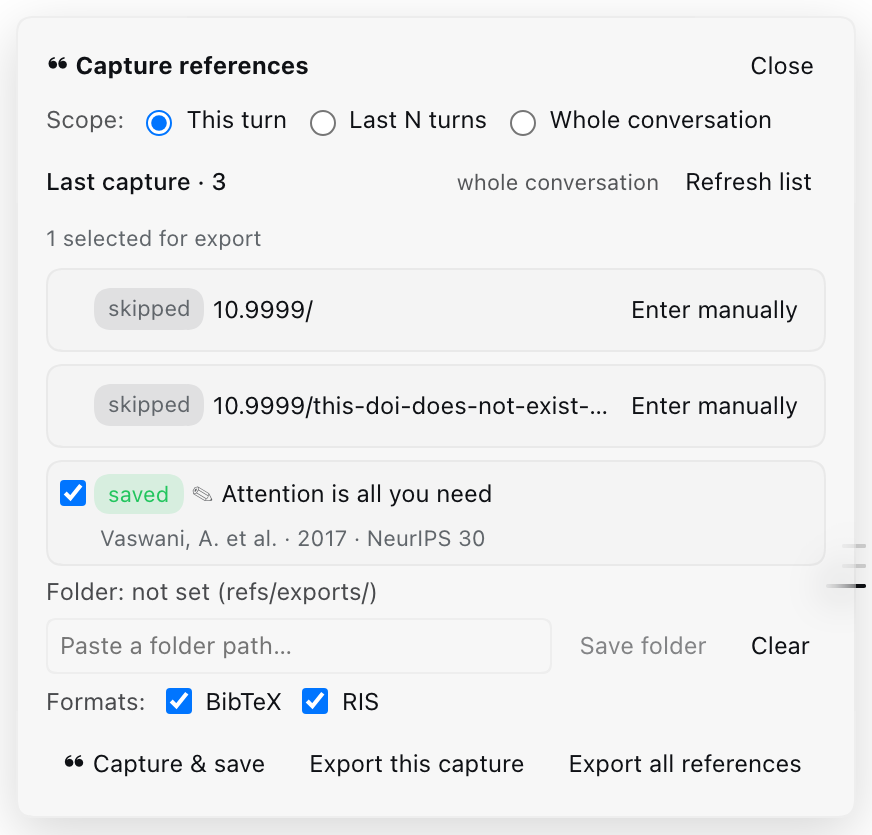

# dsh-refkeeper

**English** · [简体中文](README.zh.md)

 

**Verify and export the references your AI conversation already cited** — BibTeX/RIS, with annotations anchored to the sentences that produced them.

A plugin for [DeepSeek Harness](https://github.com/deepseek-ai/deepseek-harness) (DSH), the agent runtime whose models answer with citations in hand.



## The twenty-turn problem

You spent an afternoon with the agent on a literature review. It cited fifteen papers — some as DOIs in a tool result, some as full APA lines in a summary, one by name two turns back. Now you have to write.

You can scroll back and copy them by hand, hoping you catch the one that scrolled past. Or you can ask the model for "a `.bib` of everything we cited" and find out, at submission time, that it invented two DOIs, a page range and an author order.

`dsh-refkeeper` takes the third path: it pulls the citations out of the transcript you point at, checks each one against four registries, and exports only what survives — with the model's notes attached, and with any quoted evidence re-checked against the conversation.

## Quick start

Install it from the repository — in DSH open **Settings → Plugins**, add the GitHub spec
`github:ymwang92/dsh-refkeeper`, and turn the plugin on for your profile.

Then, in the conversation that cited the papers:

1. Pick a scope in the panel — this turn, the last N turns, or the whole session.
2. **Capture & save.** Candidates are verified and stored; failures go to the ⚠ area instead of the library.
3. Untick anything you do not want, choose BibTeX / RIS.
4. **Export this capture** → `refs/exports/` inside the session workspace, or a folder you set once.

The same flow from the keyboard:

```text
/refs capture --scope=all --save
/refs export --format=both
```

## What you get

`refs/annotated.md` — the human-readable view, written next to the JSON:

```markdown
### Physiographically sensitive mapping of temperature and precipitation across the conterminous United States

- Daly, C.; Halbleib, M.; Smith, J. I. et al. · 2008 · International Journal of Climatology 28 15 2031-2064 · DOI [10.1002/joc.1688](https://doi.org/10.1002/joc.1688)
- verification: **verified** 3/3 · crossref, openalex

> **Summary** — PRISM interpolation: temperature and precipitation grids for the conterminous US, built from station data with a physiographic adjustment.
> **Why it matters** — the dataset behind the 800 m climatology in section 3.
> **Evidence** — "we use the PRISM 800 m normals (Daly et al., 2008) as the baseline for the downscaling."
```

and the matching export:

```bibtex
@article{daly2008physiographically,
  author = {Daly, C. and Halbleib, M. and Smith, J. I. and Gibson, W. P. and Doggett, M. K.},
  title = {Physiographically sensitive mapping of temperature and precipitation across the conterminous United States},
  journal = {International Journal of Climatology},
  year = {2008},
  volume = {28},
  number = {15},
  pages = {2031--2064},
  publisher = {Wiley},
  doi = {10.1002/joc.1688},
  url = {https://doi.org/10.1002/joc.1688},
  abstract = {PRISM interpolation: temperature and precipitation grids ...}
}
```

Volume, issue, pages, publisher and language are filled from the registry record when the citation in the conversation did not carry them. Fields the conversation does not support stay out of the file entirely — no `note` reading "no citation sentence available", no invented page range.

## Four things it does

1. **Capture.** The current turn, the previous N turns, or the whole session. Candidates come from identifiers (DOI, arXiv id, ISBN, report number) and from parsed reference lines in APA, GB/T 7714 and IEEE shapes. Tool output is skipped by default — a web search echoes a dozen DOIs nobody cited, and they bury the two that were; `--include-tools` opts back in.
2. **Verify.** Crossref, OpenAlex, arXiv and DataCite are queried in parallel. An entry enters the main library only when all three gates pass *and* at least one registry answered.
3. **Annotate.** After a capture, the profile's default model writes `summary`, `relevance`, `evidence` and `caveats` for each entry, grounded in the transcript lines that cite it. `evidence` is checked verbatim: a quote that is not in the conversation is dropped. No model, or no excerpt in range? The entry stays bibliographic and the capture result says why.
4. **Export.** BibTeX and/or RIS, for the last capture, the rows you ticked, or the whole library. Deterministic output, so a diff on the `.bib` shows what actually changed.

## How it compares

| | Re-reading the transcript | "Give me a `.bib`" | `dsh-refkeeper` |
| --- | --- | --- | --- |
| Where references come from | your eyes, one scroll at a time | the model's memory | parsed from the transcript you point at |
| Metadata checked against a registry | — | no | Crossref · OpenAlex · arXiv · DataCite |
| Invented pages, DOIs, authors | — | happens, and you find out late | fields come from registry records; unsupported fields stay empty |
| Why the paper is in the manuscript | lost | lost | annotation + verbatim evidence quote |
| Reproducible, diffable export | — | no | sorted, byte-stable BibTeX/RIS |
| Citations you never used | — | included | excluded: tool output is not a citation |

## How it works

```text
conversation text
   │  identifiers (DOI · arXiv · ISBN · report no.)
   │  reference lines (APA · GB/T 7714 · IEEE)
   ▼
candidates ──► Crossref · OpenAlex · arXiv · DataCite (parallel)
   │
   ├─ three gates: title strongly matches · year within ±1 · first author matches
   │               and at least one registry returned a record
   ├─ pass ──► refs/refs.json        (verified)
   └─ fail ──► refs/quarantine.json  (⚠ kept, visible, excluded from export)
```

## Why it is built this way

**Three gates, one vote of confidence.** No single fuzzy score decides. The title must match strongly, the year must be within ±1, and the first author must match — and at least one registry has to have answered. Latin titles are compared with Jaccard over folded tokens; CJK titles with character-bigram Dice ≥ 0.90, because Romanised registry records otherwise never match a Chinese title.

**`unverified` is not `quarantined`.** If the registries cannot be reached, the entry is marked `unverified` and kept — a network being down says nothing about whether the citation is real, and it can be retried. `quarantined` means the registries answered and disagreed. Collapsing the two would either throw away good references or launder bad ones.

**Empty means empty.** Every annotation field passes a filter that rejects sentences about the absence of evidence ("the excerpt does not mention this work"). Those are not content, and in a `.bib` they read as if they were. The same filter applies at render time, so libraries written before it existed are cleaned without a re-capture.

**Exports are byte-stable.** Entries are sorted (author, year, title) and citekeys are disambiguated deterministically, so exporting the same library twice produces identical bytes.

**Writes are atomic and locked.** `refs/*.json` goes through a temporary file + rename, guarded by an on-disk lock whose stale copies are reclaimed atomically (inode + content identity, not the path alone), so two sessions capturing at once cannot half-write the library.

## Chinese references

GB/T 7714 reference lines are parsed alongside APA and IEEE, and CJK titles are matched against registry records with character-bigram similarity rather than token overlap — the only way a Chinese title matches a romanised record. Mixed Chinese/English manuscripts work; `language` is carried into both export formats.

The honest limit: open registries hold sparse metadata for Chinese journals, and CNKI / Wanfang / CQVIP are recognised as scholarly link sources when harvesting identifiers, not queried as registries. Expect more manual correction there than for an English DOI.

## The panel

| Control | What it does |
| --- | --- |
| Scope | this turn · previous N turns · whole session |
| Capture & save | captures, verifies, annotates, stores; the result lists what was saved and what went to ⚠ |
| Row checkbox | which entries the next export includes (saved rows tick by default, ⚠ rows do not) |
| Expand a row | shows the stored fields; edits are saved per entry |
| Format | BibTeX, RIS, or both |
| Folder | export destination; unset means `refs/exports/` inside the session workspace |
| Export this capture | writes the ticked entries |
| Export all references | writes the whole library |

## Commands

| I want to… | Command |
| --- | --- |
| see what the conversation cites, without writing anything | `/refs capture --scope=all --dry-run` |
| capture and store | `/refs capture --scope=lastN --turns=5 --save` |
| check one reference | `/refs verify --doi=10.1002/joc.1688` |
| read the library | `/refs list [--quarantine]` |
| fill missing volume/pages/publisher | `/refs enrich [--quarantine]` |
| fix a field | `/refs edit --id=<id> --payload=<base64url(json)>` |
| remove entries | `/refs remove <id\|doi\|arxiv>...` · `/refs remove --all --yes` |
| export | `/refs export [--format=bibtex\|ris\|both] [--all] [--ids=…] [--out=path]` |
| set the export folder once | `/refs dir --set=<base64url(path)>` · `/refs dir --clear` |

<details>
<summary>Full command reference</summary>

```text
/refs                                                     capture readiness
/refs capture [--scope=turn|lastN|all] [--turns=N] [--save] [--dry-run] [--include-tools]
/refs verify --doi=… | --arxiv=… | --title=… [--json]
/refs save --json='{…}'
/refs list [--limit=N] [--quarantine]
/refs edit --id=<id> --payload=<base64url(json)>
/refs enrich [--quarantine]
/refs remove <id|doi|arxiv>... [--quarantine]
/refs remove --all --yes [--quarantine]
/refs export [--format=bibtex|ris|both] [--out=path] [--include-quarantine]
/refs export [--ids=id,id] [--choose-dir] [--all]
/refs dir [--set=<base64url(path)>|--clear]
```

`/refs capture` without `--save` only previews candidates. Export defaults to the
last saved capture; `--all` exports the library instead. Long IDs travel
base64url-encoded because real ones contain spaces, `<>`, `;` and parentheses.

</details>

## Tools

| Tool | Purpose |
| --- | --- |
| `ref_capture` | pull candidate references out of the conversation |
| `ref_verify` | check one identifier or title against the registries |
| `ref_save` | store a reference with annotations you supply yourself |
| `ref_export` | write BibTeX/RIS for a batch, a selection, or the library |
| `ref_ping` | report which host seams and registries are reachable |

## Files

```text
refs/refs.json          verified references, with their annotations
refs/quarantine.json    ⚠ entries that failed a gate
refs/last-capture.json  what the last capture produced, and the default export scope
refs/settings.json      the remembered export folder
refs/annotated.md       the human-readable view: record, verdict, annotations
refs/exports/           default export destination
```

Plain JSON and Markdown: commit them with the manuscript, diff them, back them up.

## Data and privacy

- Outbound traffic is the identifier or title being verified, sent to Crossref, OpenAlex, arXiv and DataCite. Nothing else leaves the machine.
- Annotations are generated by the model already running this session — no extra account, no API key of the plugin's own.
- No telemetry. The library is a local JSON file.

## Limits

- **Not a Zotero replacement.** Zotero is the right tool for a personal library across years: PDFs, styles, sync, a browser connector. This plugin covers one manuscript's citations, the ones a conversation already wrote down.
- No PDF reading; everything comes from the conversation text and the registries.
- Exports only write inside the session's workspace: the host applies the `workspace-write` sandbox, so an outside folder is refused with a message rather than half-written.
- Annotating a capture costs one model call (60 s cap). A long session can hit the 12-entry per-capture annotation budget; the rest stay bibliographic.

## Install

The repository ships its built `lib/`, so a Git install is enough: **Settings → Plugins**,
add `github:ymwang92/dsh-refkeeper`, enable it for the current profile.

The npm package is the next release step; once it is published, installing by package name
becomes the shorter path.

## Roadmap

- `v0.1.x` — npm release, `awesome-dsh-plugin` listing, tag your first export.
- `v0.2` — CNKI / Wanfang parsing beyond link harvesting, GB/T 7714 output, annotation editing from the panel.
- Later — a Zotero import/export bridge, so this is a capture step, not a silo.

## Development

```sh
npm ci
npm test          # vitest
npm run typecheck
npm run build     # tsdown (host) + client bundle
```

`tsdown` clears `lib/`, so run the client bundle after it. Tests run on Node 22+.

## License

MIT. See [LICENSE](LICENSE).
