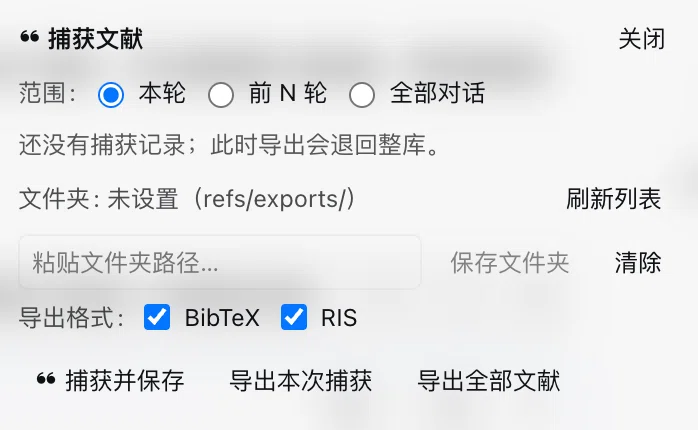

# dsh-refkeeper

[English](README.md) · **简体中文**

 

**面向「对话里已经被引用过的文献」的引用管理器。** 它把这些文献从对话里取出来，逐个用四个注册表核对，再导出成 BibTeX 或 RIS——如果模型留下了注解，注解也一起带走。



DeepSeek Harness 的模型会在回答里随手引文：工具结果里的一个 DOI、一段 APA 格式的参考文献、两轮前提到的某份报告。`dsh-refkeeper` 把这些收集起来，用 Crossref / OpenAlex / arXiv / DataCite 核对，只留下通过校验的条目。

## 两层内容：文献记录，以及对它的解读

每条目都先有一条书目记录和一个校验结论——标题、作者、年份、出处、标识符，以及 `verification: verified 3/3 · crossref, openalex`。这一层永远存在，无论从哪条路径进来。

在这之上是四个**可选**注解字段。模型通过 `ref_save` 保存文献时会填上它们；存在时，它们随条目一路进入导出结果：

| 注解 | 回答什么问题 | 落到哪里 |
| --- | --- | --- |
| `summary` | 这篇工作到底说了什么 | BibTeX `abstract`、RIS `AB`、`annotated.md` |
| `relevance` | 它与**当前这项任务**什么关系 | RIS `N1`、`annotated.md` |
| `evidence` | 对话里哪句话支撑它 | RIS `N1`（`Evidence: …`）、`annotated.md` |
| `caveats` | 引用前该知道的限制 | BibTeX `note`、RIS `N1`（`Caveats: …`）、`annotated.md` |

从面板「捕获并保存」得到的条目只有书目记录，没有注解。两种情况导出与 `annotated.md` 都正常：没有注解的条目照样完整写出，结论也在。注解增加的是可追溯性——这篇工作为什么在稿子里，以及是哪句话把它带进来的。

## 能做什么

1. **捕获**：当前轮、前 N 轮或整个会话。候选来自标识符（DOI、arXiv id、ISBN、报告号）与 APA / GB/T 7714 / IEEE 形态的参考文献行。工具输出默认不计入——搜索结果会回显一堆没人引用的 DOI，把候选淹没；需要时用 `--include-tools` 显式打开。
2. **校验**：并行查询四个注册表。三门全过、且至少一个源返回记录，条目才进主表。
3. **注解**：上面四个字段由模型生成，可在面板里修改，并随条目一起导出。
4. **导出**：BibTeX 和/或 RIS，范围可以是最近一次捕获、你勾选的条目、或整个库；写进 `refs/exports/` 或你设定一次的文件夹。

## 工作原理

```text
对话文本
   │  标识符（DOI · arXiv · ISBN · 报告号）
   │  参考文献行（APA · GB/T 7714 · IEEE）
   ▼
候选 ──► Crossref · OpenAlex · arXiv · DataCite（并行）
   │
   ├─ 三门：标题强重合 · 年份 ±1 · 首作者匹配
   │       且至少一个源返回了记录
   ├─ 通过 ──► refs/refs.json        已校验
   └─ 未过 ──► refs/quarantine.json  ⚠ 保留、可见、不参与默认导出
```

**三门校验，一个置信结论。** 不靠单一模糊分数：标题必须强重合——拉丁文按折叠后的词元算 Jaccard，中文标题按字符二元组 Dice ≥ 0.90（这是把中文标题和注册表返回的罗马化记录放在一起比较唯一靠谱的办法）。卷、期、页码、出版社、语言在引文未携带时从注册表记录补齐。

**`unverified` 不等于 `quarantined`。** 注册表连不上时条目记为 `unverified` 并保留——网络挂了并不能说明这条引用是假的，稍后可以重试；`quarantined` 表示注册表答复了、但不同意。把两者合并，要么丢掉好文献，要么把假文献洗白。

**导出字节稳定。** 条目按（作者、年份、标题）排序，citekey 确定性去重，因此同一份库导出两次得到完全相同的文件——`.bib` 的 diff 只会显示真正变了的条目。

**写入原子且有锁。** `refs/*.json` 通过临时文件 + rename 落盘，外面套一层磁盘锁；陈旧锁按 inode + 内容身份原子回收（不看路径单值），所以两个会话同时捕获也不会写出半个库。

**工具输出默认排除。** 一次网页搜索结果会带十几个没人引用的 DOI，把真正被引用的那些埋掉。默认只信任 user 与 assistant 的正文，需要时用 `--include-tools` 打开。

## 安装

现在即可从仓库安装（仓库里带了构建好的 `lib/`）：

```sh
dsh plugin --profile <profile> add github:ymwang92/dsh-refkeeper
```

npm 发布之后可以改用短名：

```sh
dsh plugin --profile <profile> add dsh-refkeeper
```

之后重启 DeepSeek Harness（或在插件页重载）。面板出现在输入框上方。

## 面板

| 控件 | 作用 |
| --- | --- |
| 范围 | 本轮 · 前 N 轮 · 整个会话 |
| 捕获并保存 | 捕获、校验并入库；结果会列出存了几条、几条进了 ⚠ |
| 行首勾选框 | 决定本次导出包含哪些条目（已入表默认勾选，⚠ 默认不勾） |
| 展开行 | 显示已存字段（含四个注解），修改按条目保存 |
| 导出格式 | BibTeX、RIS 或两者 |
| 文件夹 | 导出目的地；不改则用会话工作区内的 `refs/exports/` |
| 导出本次捕获 | 写出勾选的条目 |
| 导出全部文献 | 写出整个库 |

## 命令

```text
/refs                                                    捕获就绪状态
/refs capture [--scope=turn|lastN|all] [--turns=N] [--save] [--dry-run] [--include-tools]
/refs verify --doi=… | --arxiv=… | --title=… [--json]
/refs save --json='{…}'
/refs list [--limit=N] [--quarantine]
/refs edit --id=<id> --payload=<base64url(json)>
/refs enrich [--quarantine]
/refs remove <id|doi|arxiv>... [--quarantine]
/refs remove --all --yes [--quarantine]
/refs export [--format=bibtex|ris|both] [--out=path] [--include-quarantine]
/refs export [--ids=id,id] [--choose-dir] [--all]
/refs dir [--set=<base64url(path)>|--clear]
```

`/refs capture` 不带 `--save` 只预览候选。导出默认范围是最近一次保存的捕获；`--all` 改为导整个库。真实 id 里含空格、`<>`、`;` 和括号，所以长参数统一走 base64url 传输。

## 工具

| 工具 | 用途 |
| --- | --- |
| `ref_capture` | 从对话中抽取候选文献 |
| `ref_verify` | 用注册表核对一个标识符或标题 |
| `ref_save` | 连注解一起存储一条文献 |
| `ref_export` | 按批次、按勾选、或按整个库导出 BibTeX/RIS |
| `ref_ping` | 报告宿主接缝与注册表是否可达 |

## 文件

都放在工作区根目录的 `refs/`：

```text
refs/refs.json          通过校验的条目，含注解
refs/quarantine.json    ⚠ 未通过某一门的条目
refs/last-capture.json  最近一次捕获的产物，也是默认导出范围
refs/settings.json      记住的导出文件夹
refs/annotated.md       人类可读视图：书目记录、校验结论，以及（若有）注解
refs/exports/           默认导出目的地
```

纯 JSON / Markdown：可以和稿件一起提交、diff、备份。

## 数据与隐私

- 对外流量只有你要核对的标识符或标题，发往 Crossref、OpenAlex、arXiv、DataCite；除此之外没有数据外发。
- 不需要 API key、不需要账号、没有遥测。
- 库就是本地一个 JSON 文件，不涉及任何同步服务。

## 已知边界

- **不是 Zotero 的替代品。** 跨年份管理个人文献库（PDF、样式、同步、浏览器插件）该用 Zotero；本插件覆盖的是「一篇稿件里、对话中已经被写下来的那些引用」。
- 不读 PDF：内容来自对话文本与注册表。
- 导出只写会话工作区内：宿主按 `workspace-write` 策略裁决，工作区外的文件夹会被明确拒绝，而不是写出半个文件。
- 中文期刊元数据在开放注册表里比英文稀疏。非拉丁标题用 CJK 感知的相似度匹配，从 URL 里提取标识符时接受 CNKI / 万方 / 维普等学术站点；但 v0.1 不声称把这些站点当作注册表来解析。

## 开发

```sh
npm ci
npm test          # vitest
npm run typecheck
npm run build     # tsdown + 客户端 bundle
```

## 许可

MIT，见 [LICENSE](LICENSE)。
